# Gestion de stock — Dossier d'analyse et de modélisation UML

Version consolidée du 13/11/2026, décisions ouvertes validées. Ce document intègre toutes les décisions prises à cette date, y compris la caisse intégrée, la vente à crédit, la vente au détail et le contexte d'exploitation au Cameroun.

---

## 1. Contexte, objectifs et périmètre

Le système gère le stock d'une seule entreprise de négoce, de taille petite à moyenne, exploitée sur un ou plusieurs sites (entrepôts et magasins de vente directe). Il trace chaque unité de la réception fournisseur jusqu'à la vente au comptoir ou à l'expédition client, par emplacement et, si nécessaire, par lot ou numéro de série. Il intègre une caisse, car la plupart des petites boutiques n'ont pas de logiciel de caisse.

### 1.1 Objectifs

1. Connaître à tout instant le stock physique, réservé, bloqué, disponible et projeté, par article, site, emplacement et lot.
2. Vendre au comptoir avec une caisse intégrée qui fonctionne même sans connexion, et ne bloque jamais un passage en caisse.
3. Empêcher la survente sur les commandes clients grâce à une réservation transactionnelle (module activable).
4. Gérer la vente à crédit et la vente au détail, pratiques courantes des petites boutiques.
5. Garantir la traçabilité ascendante (lot → fournisseur) et descendante (lot → clients ou magasins), notamment pour un rappel de lot.
6. Identifier articles, lots, emplacements et colis par scan : codes-barres linéaires (EAN-13, GS1-128), GS1 DataMatrix et QR GS1 Digital Link.
7. Produire les reçus de vente et des exports comptables exploitables par un comptable externe, sans dépendre d'un ERP.

### 1.2 Périmètre de la version 1

| Module | Inclus | Exclu (v1) |
| --- | --- | --- |
| Référentiel | Articles, unités et conditionnements, sites (entrepôts et magasins), emplacements, fournisseurs, clients | Catalogue e-commerce |
| Prix | Prix de vente par conditionnement, éventuellement par site | Tarification par client, promotions complexes |
| Achats et réceptions | Commande fournisseur, réception partielle (y compris directe en magasin), contrôle, mise en stock, frais d'approche | Appels d'offres, contrats fournisseurs |
| Caisse intégrée | Vente au comptoir, reçus, modes de paiement (espèces, Mobile Money, carte, crédit), avoirs, sessions et clôture de caisse | Programme de fidélité |
| Clients et crédit | Comptes clients, plafond, ventes à crédit, remboursements, liste des impayés | Relances automatiques, pénalités, lettrage comptable |
| Commandes clients (activable) | Commande, réservation, préparation, expédition, livraison partielle, retours | — |
| Magasin | Réassort réserve → rayon, démarque (casse, vol, périmés, freinte) | Étiquettes électroniques de gondole |
| Multi-sites (activable) | Transferts entrepôt → magasin et entre sites, mouvements internes | Planification du transport |
| Traçabilité (activable) | Lots, numéros de série, DLC, sortie FEFO, blocage et rappel de lot | — |
| Identification | Codes multiples par article et conditionnement, étiquettes d'emplacement, SSCC, décodage GS1, impression d'étiquettes et de reçus | RFID |
| Inventaire | Inventaire annuel et tournant, validation des écarts | — |
| Réapprovisionnement | Suggestions par point de commande et stock de sécurité, par site | Prévision statistique de la demande |
| Exports comptables | Journaux des ventes, achats, encaissements et créances ; valeur du stock ; Excel et CSV | Tenue de la comptabilité, déclarations fiscales, factures normalisées DGI |

### 1.3 Hypothèses

- L'entreprise n'a pas d'ERP comptable. Un connecteur ERP reste possible en option.
- L'application est utilisée principalement sur PC ou portable, via un navigateur.
- Chaque article a un seul mode de suivi : aucun, par lot ou par numéro de série.
- Une seule société juridique ; le multi-société est hors périmètre.

### 1.4 Paramétrage selon la taille de l'entreprise

Une boutique d'un seul site ne doit pas subir la complexité d'un entrepôt. Les fonctionnalités suivantes sont activables par paramétrage (RG38). La configuration par défaut est : un site, sans terminaux, sans lots, sans commandes clients.

| Fonctionnalité | Par défaut | Utile pour |
| --- | --- | --- |
| Multi-sites et transferts | Désactivée | Entreprise avec entrepôt et magasins |
| Séparation réserve / rayon | Désactivée | Magasins à forte rotation |
| Lots, séries, DLC | Désactivée | Alimentaire, pharmacie, électronique |
| Commandes clients avec réservation | Désactivée | Vente aux professionnels, livraison |
| Gestion par emplacements scannés | Désactivée | Entrepôt |
| Terminaux de scan Android | Désactivée | Entrepôt et réserve à fort volume |
| Vente à crédit | Activée | Boutiques de quartier |

### 1.5 Contexte d'exploitation : Cameroun

| Contrainte | Impact | Traitement |
| --- | --- | --- |
| Connectivité Internet et alimentation électrique irrégulières selon les sites | Les sites doivent continuer à vendre, recevoir et ranger sans connexion | Mode dégradé hors ligne (RG31, ENF08, 7.8) |
| Loi n° 2024/017 sur les données personnelles, en vigueur depuis le 23 juin 2026 | Un transfert de données personnelles hors du Cameroun requiert une autorisation préalable de l'Autorité de protection des données | Choix d'hébergement (7.8, point 16) |
| Facturation électronique introduite par la loi de finances 2026, déploiement progressif, spécifications techniques non encore publiées | La caisse intégrée devra pouvoir s'y conformer si l'entreprise y est assujettie | Point 17 |
| Monnaie : franc CFA (XAF), sans subdivision en usage | Montants affichés et exportés sans décimales | RG32 |
| Référentiel comptable SYSCOHADA révisé | Le CUMP est une méthode admise ; le coût d'entrée inclut les frais accessoires d'achat | RG17, RG30 |
| TVA à 19,25 % (17,5 % + 10 % de centimes additionnels communaux) ; beaucoup de petites entreprises relèvent d'un régime sans TVA | Reçus avec ou sans détail de TVA ; stock valorisé hors TVA récupérable | RG30, RG37 |
| Préfixe GS1 Cameroun « 617 » ; codes-barres parfois non conformes sur des produits locaux | Codes en double, invalides ou absents | RG33 |
| Deux langues officielles : français et anglais | Interface, étiquettes et reçus bilingues | ENF09 |
| Fuseau Africa/Douala (UTC+1, sans heure d'été) | Stockage en UTC, affichage local | ENF07 |

---

## 2. Acteurs et cas d'utilisation

### 2.1 Acteurs

| Acteur | Type | Rôle |
| --- | --- | --- |
| Caissier | Humain | Encaisse les ventes, émet reçus et avoirs, enregistre les remboursements de crédit, clôture sa caisse |
| Responsable de magasin | Humain | Gère les prix, valide écarts de caisse, démarque et dépassements de crédit, commande à l'entrepôt |
| Employé de rayon | Humain | Réassort réserve → rayon, contrôle des DLC, déclaration de démarque |
| Magasinier | Humain | Réceptionne, range, compte, traite les retours |
| Acheteur | Humain | Passe et suit les commandes fournisseurs, saisit les frais d'approche |
| ADV (administration des ventes) | Humain | Saisit et suit les commandes clients (module activable) |
| Préparateur | Humain | Prélève, emballe, expédie (module activable) |
| Gestionnaire de stock | Humain | Paramètre, transfère, valide les écarts d'inventaire, bloque les lots, produit les exports |
| Comptable (externe) | Humain | Reçoit les exports comptables |
| Caisse externe | Système (option) | Envoie des tickets si l'entreprise conserve un logiciel de caisse existant |
| Boutique en ligne | Système (option) | Envoie des commandes, consulte le disponible |
| ERP comptable | Système (option) | Reçoit les mouvements valorisés si l'entreprise en possède un |

### 2.2 Cas d'utilisation

| ID | Cas d'utilisation | Acteur principal | Relations |
| --- | --- | --- | --- |
| UC01 | Gérer les articles (mode de suivi, unités, conditionnements, précision, DLC, seuils) | Gestionnaire de stock | — |
| UC02 | Gérer les sites et emplacements | Gestionnaire de stock | — |
| UC03 | Créer et valider une commande fournisseur | Acheteur | étendu par UC15 |
| UC04 | Réceptionner une livraison fournisseur | Magasinier | inclut « Contrôler la réception », « Saisir lots/séries/DLC », « Répartir les frais d'approche » |
| UC05 | Mettre en stock (rangement) | Magasinier | suit UC04 |
| UC06 | Saisir une commande client | ADV, Boutique en ligne | inclut UC07 |
| UC07 | Réserver du stock | Système | — |
| UC08 | Préparer une commande (picking FEFO) | Préparateur | inclut « Allouer lots et emplacements » |
| UC09 | Expédier une commande | Préparateur | — |
| UC10 | Transférer du stock entre sites | Gestionnaire de stock | — |
| UC11 | Réaliser un inventaire | Magasinier | inclut « Valider les écarts » |
| UC12 | Traiter un retour client (hors caisse) | Magasinier | — |
| UC13 | Bloquer ou rappeler un lot | Gestionnaire de stock | inclut « Tracer les clients livrés » |
| UC14 | Consulter disponibilités et mouvements | Tous | — |
| UC15 | Générer les suggestions de réapprovisionnement | Système (planifié) | — |
| UC16 | Exporter les journaux comptables (ventes, achats, encaissements, créances, valeur du stock) | Gestionnaire de stock | — |
| UC17 | Encaisser une vente au comptoir | Caissier | inclut UC22 |
| UC18 | Émettre un avoir (retour en caisse) | Caissier | — |
| UC19 | Réassortir un rayon depuis la réserve | Employé de rayon | — |
| UC20 | Déclarer une démarque connue | Employé de rayon | validée par le Responsable de magasin |
| UC21 | Commander à l'entrepôt | Responsable de magasin | génère un transfert UC10 |
| UC22 | Résoudre un code scanné (EAN, GS1-128, DataMatrix, QR, code interne) | Système | utilisé par UC04, UC05, UC08, UC11, UC17, UC19 |
| UC23 | Imprimer des étiquettes (article, lot, emplacement, colis SSCC) | Magasinier, Gestionnaire | — |
| UC24 | Ouvrir et clôturer une session de caisse | Caissier | validée par le Responsable de magasin |
| UC25 | Gérer les prix de vente | Responsable de magasin | — |
| UC26 | Gérer les clients et leur crédit | Responsable de magasin | — |
| UC27 | Enregistrer un remboursement de crédit | Caissier | — |
| UC28 | Intégrer un ticket d'une caisse externe | Caisse externe (option) | inclut UC22 |

Les fiches détaillées (préconditions, scénario nominal, alternatives) sont à rédiger en priorité pour UC04, UC07, UC08 et UC17.

---

## 3. Règles de gestion

La règle structurante est RG01 : le stock n'est jamais modifié directement, il résulte d'un journal de mouvements immuables.

### 3.1 Stock, réservation, traçabilité

| ID | Domaine | Règle |
| --- | --- | --- |
| RG01 | Stock | Toute variation de stock est un mouvement immuable. Une erreur se corrige par un mouvement inverse, jamais par modification ou suppression. |
| RG02 | Stock | Disponible = physique − réservé − bloqué (quarantaine, lot bloqué, lot périmé). |
| RG03 | Stock | Le stock physique ne peut pas devenir négatif, sauf sur l'emplacement de vente d'un magasin (RG22). |
| RG04 | Réservation | Une réservation ne peut excéder le disponible au moment de la transaction, y compris en cas d'accès concurrents. |
| RG05 | Réservation | La réservation se fait au niveau article × site à la confirmation ; l'affectation au lot et à l'emplacement se fait au lancement de la préparation. |
| RG06 | Réservation | L'annulation d'une commande ou d'une ligne libère ses réservations. |
| RG07 | Traçabilité | Un article suivi par lot exige un numéro de lot à chaque entrée et sortie. |
| RG08 | Traçabilité | Un article suivi par série exige un numéro unique par unité ; un numéro ne peut être en stock qu'à un seul endroit. |
| RG09 | Traçabilité | Un article géré en DLC est obligatoirement suivi par lot, avec date de péremption saisie à la réception. |
| RG10 | Sortie | Sortie en FEFO pour les articles à DLC, en FIFO sinon. Toute dérogation est tracée avec un motif. |
| RG11 | Sortie | Un lot périmé ou bloqué n'est ni réservable ni prélevable. La DLC résiduelle minimale du client (en jours, 0 par défaut) est respectée à l'allocation. |
| RG12 | Réception | La réception partielle est autorisée. La surlivraison est refusée au-delà de la tolérance du fournisseur (0 % par défaut). |
| RG13 | Réception | La marchandise reçue arrive sur un emplacement de réception ou de quarantaine ; elle devient disponible après rangement et, si requis, contrôle qualité. Sans gestion par emplacements, elle est disponible dès la validation. |
| RG14 | Transfert | Un transfert entre sites sort le stock de la source vers un emplacement « en transit », puis l'entre à la réception de la destination. |
| RG15 | Inventaire | Un écart d'inventaire au-delà d'un seuil (quantité ou valeur) doit être validé par le Gestionnaire de stock. |
| RG16 | Inventaire | Pendant le comptage d'un emplacement, ses mouvements sont bloqués ou horodatés pour recalculer l'écart. |
| RG17 | Valorisation | Valorisation au coût unitaire moyen pondéré (CUMP), recalculé à chaque entrée, par article × site. |
| RG18 | Unités | Chaque article a une unité de stock ; les conditionnements d'achat et de vente s'y convertissent par un facteur fixe. |
| RG19 | Réappro | Point de commande et stock de sécurité sont définis par article × site. Une suggestion est créée quand le stock projeté passe sous le point de commande. |

Formule du point de commande (RG19) : PC = d̄ × L + SS, où d̄ est la consommation moyenne journalière, L le délai fournisseur en jours et SS le stock de sécurité.

### 3.2 Magasin et identification

| ID | Domaine | Règle |
| --- | --- | --- |
| RG20 | Magasin | Un site est un entrepôt ou un magasin. Un magasin possède au minimum un emplacement de vente ; avec la séparation réserve / rayon, il possède Réception, Réserve, Rayon et Démarque. |
| RG21 | Magasin | Une vente en caisse ne passe pas par une réservation : chaque ligne de ticket génère un mouvement VenteCaisse depuis l'emplacement de vente. |
| RG22 | Magasin | Un passage en caisse n'est jamais refusé pour stock insuffisant. Le stock théorique de l'emplacement de vente peut devenir négatif ; l'anomalie est signalée et corrigée par comptage. |
| RG23 | Magasin | La démarque connue (casse, vol constaté, périmé retiré, freinte) est un mouvement Demarque avec motif. La démarque inconnue n'apparaît qu'à l'inventaire. |
| RG24 | Traçabilité | Si le code scanné en caisse porte le lot et la DLC (GS1 DataMatrix ou QR GS1 Digital Link), la vente décrémente ce lot. Sinon, le lot est affecté par FEFO et marqué « présumé ». |
| RG25 | Traçabilité | Avec un code 2D, la caisse refuse un lot bloqué ; avec un EAN-13, une alerte de retrait en rayon est émise au niveau article. |
| RG26 | Identification | Un article peut avoir plusieurs codes (GTIN par conditionnement, code fournisseur, code interne). Un code actif désigne un seul couple article × conditionnement. |
| RG27 | Identification | Les articles à poids ou prix variable utilisent des codes internes à préfixe 2 qui encodent l'article et le poids ou le prix ; la quantité vendue est extraite du code. Structure à confirmer avec GS1 Cameroun. |
| RG28 | Identification | Lorsque la gestion par emplacements est activée, chaque emplacement porte une étiquette scannable, et rangement, préparation et comptage exigent son scan. |
| RG29 | Identification | Les colis et palettes portent un SSCC (AI 00). Scanner un SSCC à la réception propose son contenu annoncé, si le fournisseur envoie un avis d'expédition. |

### 3.3 Contexte camerounais

| ID | Domaine | Règle |
| --- | --- | --- |
| RG30 | Valorisation | Le coût d'entrée en stock inclut les frais d'approche (transport, transit, droits de douane non récupérables), répartis sur les lignes de réception ; la TVA récupérable en est exclue. Des frais connus après la réception donnent lieu à un mouvement de revalorisation, sans changement de quantité. |
| RG31 | Exploitation | Les opérations physiques (vente en caisse, réception, rangement, réassort, comptage) restent possibles hors ligne et sont rejouées à la reconnexion. Les opérations qui engagent le stock central (réservation, confirmation de commande client, transfert, validation d'écart) exigent une connexion. |
| RG32 | Monnaie | Les montants sont en XAF. Les calculs internes (CUMP, valorisation) gardent 4 décimales ; affichage, reçus et exports sont arrondis à l'unité. |
| RG33 | Identification | À la création d'un code, le système contrôle la clé de contrôle et l'unicité. Un code invalide ou déjà attribué est refusé. Un article sans GTIN fiable reçoit un code interne imprimé en étiquette. |

### 3.4 Caisse, prix et paramétrage

| ID | Domaine | Règle |
| --- | --- | --- |
| RG34 | Caisse | Les tickets sont numérotés de façon continue par caisse et ne sont jamais modifiés ni supprimés. Une erreur se corrige par un avoir. |
| RG35 | Caisse | Modes de paiement : espèces, Mobile Money (référence de transaction obligatoire), carte, crédit. Un ticket peut combiner plusieurs modes. |
| RG36 | Caisse | Chaque session de caisse s'ouvre avec un fond de caisse et se clôture par un comptage des espèces ; l'écart est enregistré et validé. La clôture est impossible tant que des ventes hors ligne ne sont pas synchronisées. |
| RG37 | Prix | L'application est la seule référence des prix de vente. Si l'entreprise est assujettie à la TVA, le reçu détaille HT, TVA 19,25 % et TTC ; sinon il affiche des prix nets. |
| RG38 | Paramétrage | Les fonctionnalités de la section 1.4 sont activables par paramétrage ; la configuration par défaut est un site sans terminaux, lots ni commandes clients. |

Toute remise manuelle et toute annulation de ligne ou de ticket sont réservées aux utilisateurs autorisés, plafonnées par rôle et journalisées.

### 3.5 Vente à crédit

| ID | Domaine | Règle |
| --- | --- | --- |
| RG39 | Crédit | « Crédit » est un mode de paiement. Il exige un client identifié (nom et téléphone au minimum). |
| RG40 | Crédit | Chaque client a un plafond de crédit. Une vente qui le dépasse est refusée, sauf validation par un utilisateur autorisé, tracée. |
| RG41 | Crédit | La marchandise sort du stock à la vente, même à crédit : le crédit concerne le paiement, pas la livraison. |
| RG42 | Crédit | Un remboursement est un encaissement dans la session de caisse (espèces ou Mobile Money) ; il peut être partiel et s'impute sur les ventes les plus anciennes. |
| RG43 | Crédit | Le système liste les clients dont une dette dépasse le délai de paiement ; les exports comptables incluent le journal des créances. |

### 3.6 Vente au détail

| ID | Domaine | Règle |
| --- | --- | --- |
| RG44 | Détail | L'unité de stock d'un article est la plus petite unité vendue (pièce, kg, litre). Achats et ventes en conditionnement sont convertis par le facteur du conditionnement (RG18). |
| RG45 | Détail | Le prix de vente est défini par conditionnement : le prix d'un sac peut être inférieur à 50 fois le prix du kg. |
| RG46 | Détail | Chaque article définit sa précision de quantité : entière pour les pièces, jusqu'à 3 décimales pour le poids ou le volume. Sans balance connectée, le caissier saisit la quantité pesée. |
| RG47 | Détail | Les pertes liées au détail (pesées, freinte) sont constatées à l'inventaire et enregistrées en démarque avec le motif « freinte ». |

---

## 4. Modèle du domaine

Le modèle sépare un noyau de stock (référentiel, mouvements, soldes), des documents de flux (commandes, réceptions, préparations, inventaires) et la caisse. Seul le noyau écrit des mouvements ; les autres modules le sollicitent.

### 4.1 Noyau de stock et traçabilité

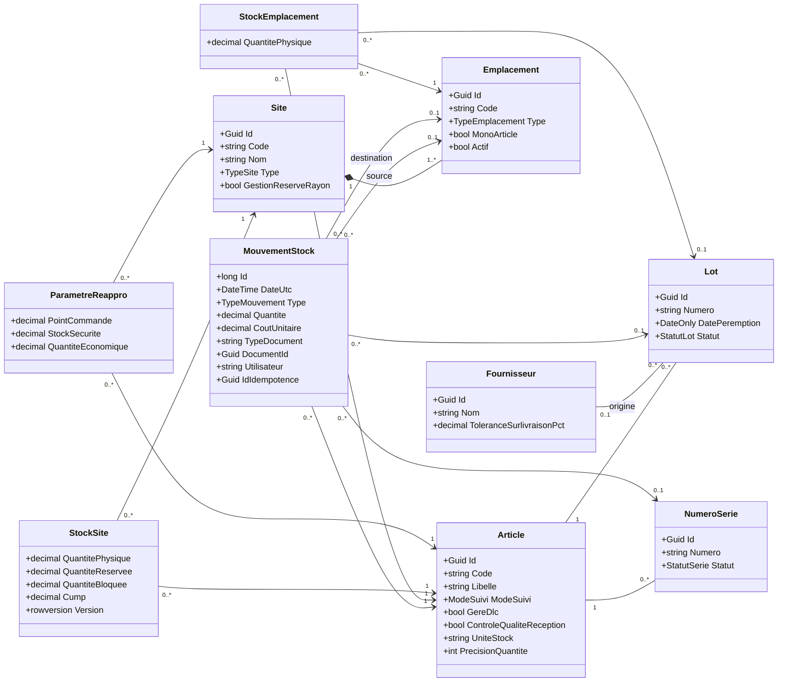

### 4.2 Documents de flux

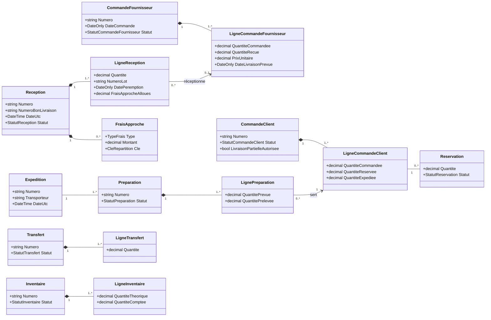

Pour la lisibilité, les associations vers Article, Site, Emplacement, Lot, Fournisseur et Client sont omises : chaque ligne de document référence un article, et selon le cas un emplacement, un lot ou un numéro de série.

### 4.3 Identification et conditionnements

Les codes et les prix sont rattachés au conditionnement, pas à l'article : scanner un carton compte directement ses unités et applique le prix du carton.

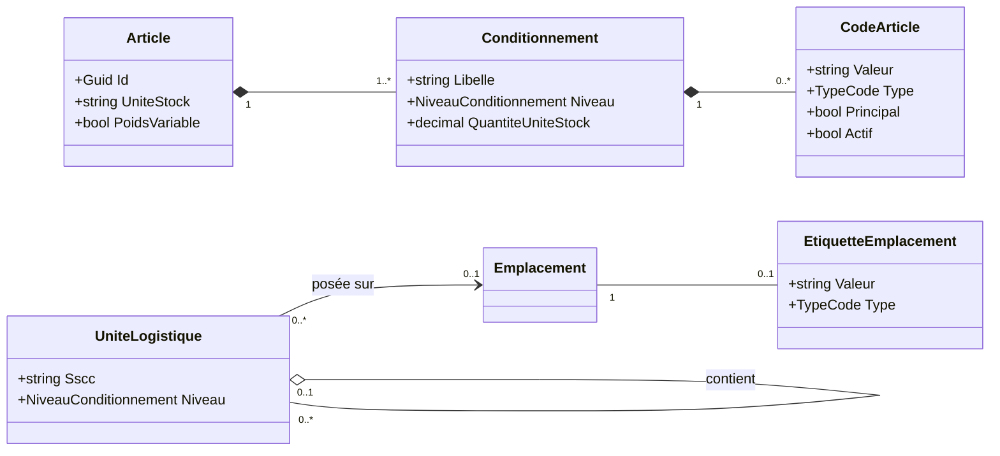

### 4.4 Caisse, prix et crédit

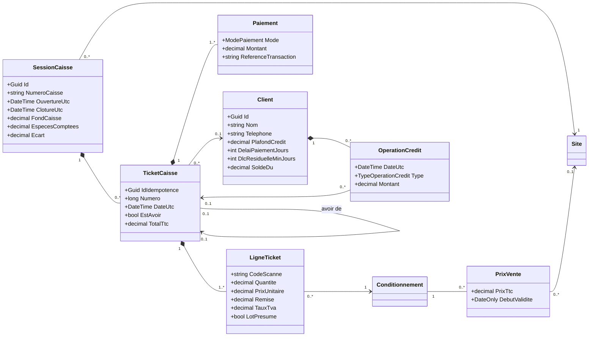

### 4.5 Énumérations

| Énumération | Valeurs |
| --- | --- |
| TypeSite | Entrepot, Magasin |
| ModeSuivi | Aucun, Lot, Serie |
| TypeEmplacement | Reception, Stockage, Preparation, Expedition, Quarantaine, Transit, Retour, Vente, Reserve, Rayon, Demarque |
| TypeMouvement | EntreeReception, SortieExpedition, Rangement, Reassort, TransfertSortie, TransfertEntree, AjustementInventaire, VenteCaisse, AvoirCaisse, RetourClient, RetourFournisseur, Demarque, Rebut, Blocage, Deblocage, Revalorisation |
| StatutLot | Quarantaine, Disponible, Bloque, Perime, Epuise |
| TypeCode | Ean13, Ean8, UpcA, Gs1_128, Gs1DataMatrix, QrGs1DigitalLink, Code128Interne, QrInterne |
| NiveauConditionnement | Unite, Pack, Carton, Sac, Palette |
| ModePaiement | Especes, MobileMoney, Carte, Credit |
| TypeOperationCredit | VenteCredit, Remboursement, Annulation |
| TypeFrais | Transport, Transit, Douane, Autre |
| CleRepartition | Valeur, Poids, Quantite |

### 4.6 Choix de conception

- **Deux projections de solde.** StockEmplacement répond à « où est la marchandise ? » (article × emplacement × lot). StockSite porte le réservé et le CUMP, et sert de point de contrôle de RG04 : c'est la seule ligne à verrouiller lors d'une réservation.
- **Cohérence.** Un mouvement et la mise à jour des projections sont écrits dans une même transaction. Les projections (soldes de stock, Client.SoldeDu) restent recalculables depuis leurs journaux, ce qui permet un contrôle de cohérence nocturne.
- **Source et destination.** Une entrée n'a qu'une destination, une sortie qu'une source, un mouvement interne les deux. Un transfert produit deux mouvements via l'emplacement Transit.
- **Lien vers le document d'origine.** Le couple TypeDocument + DocumentId évite une clé étrangère par type de document, au prix de l'intégrité référentielle en base. Point ouvert (section 8).
- **Idempotence.** Tout ce qui peut être créé hors ligne (tickets, mouvements des terminaux) porte un identifiant généré par le client : un renvoi après coupure n'est intégré qu'une fois.
- **Unicité des codes.** Index unique filtré sur CodeArticle.Valeur pour les codes actifs. Un code réattribué est désactivé, jamais supprimé.
- **Codes 2D.** On stocke le GTIN ; lot, DLC et numéro de série sont extraits à chaque scan.

---

## 5. Cycles de vie

### 5.1 Commande fournisseur

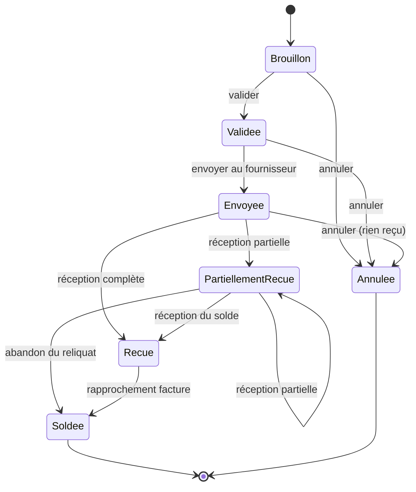

Une commande déjà partiellement reçue ne s'annule pas : on solde le reliquat.

### 5.2 Commande client (module activable)

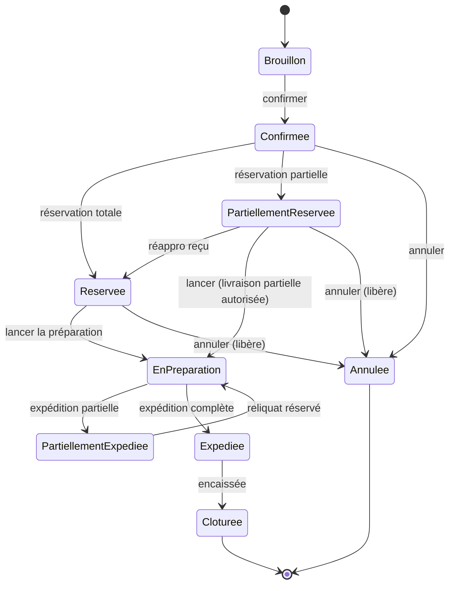

### 5.3 Lot

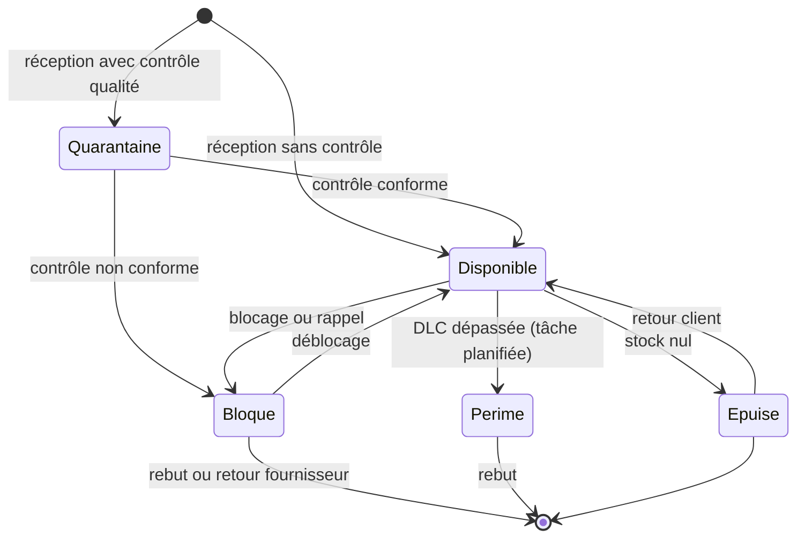

Les requêtes de disponibilité filtrent sur la DLC elle-même, sans dépendre de l'heure d'exécution de la tâche planifiée.

### 5.4 Session de caisse

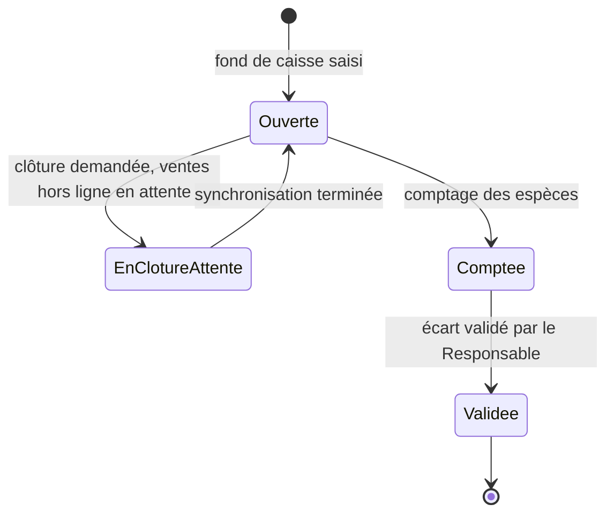

---

## 6. Processus métier

Les étapes encadrées d'astérisques écrivent des mouvements de stock.

### 6.1 Réception fournisseur

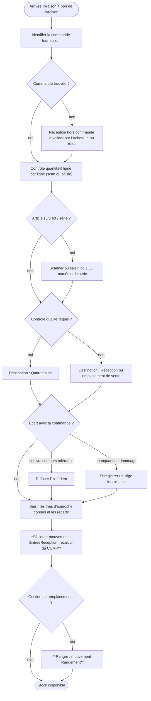

### 6.2 Commande client (module activable)

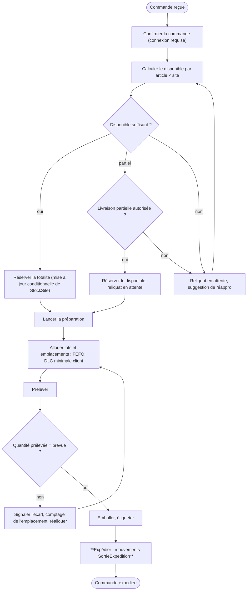

### 6.3 Vente au comptoir

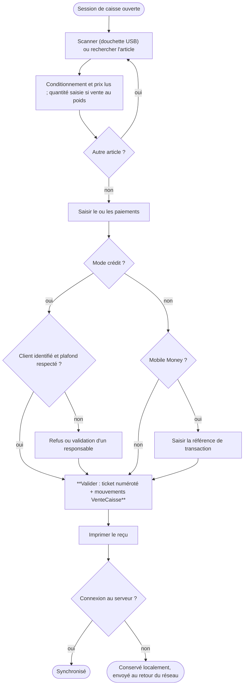

### 6.4 Réassort d'un rayon (séparation réserve / rayon activée)

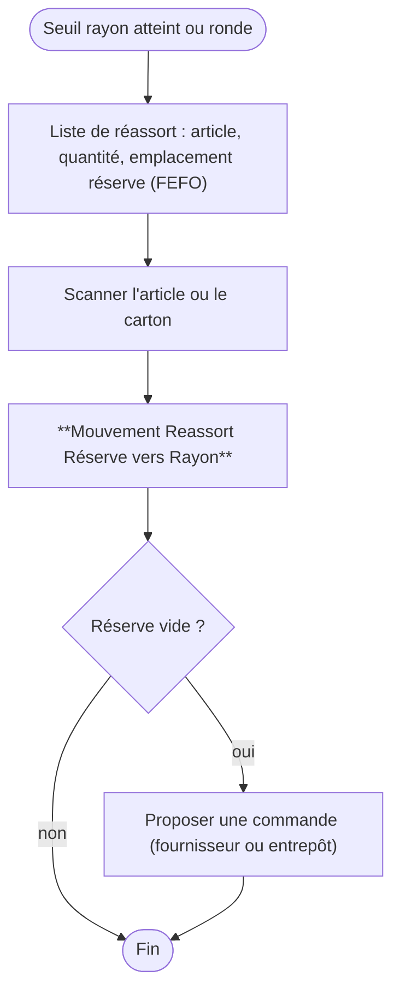

### 6.5 Ticket d'une caisse externe (option)

Le ticket reçu est contrôlé (identifiant déjà intégré ? → ignoré), chaque code est résolu (UC22), puis un mouvement VenteCaisse est créé depuis l'emplacement de vente. Un code inconnu met la ligne en anomalie pour traitement manuel.

---

## 7. Exigences non fonctionnelles et architecture

### 7.1 Exigences non fonctionnelles

| ID | Exigence | Critère de vérification |
| --- | --- | --- |
| ENF01 | Aucune survente sous charge concurrente (commandes clients) | N réservations simultanées sur un stock de 1 donnent exactement 1 succès |
| ENF02 | Traçabilité complète | Pour tout lot : fournisseur, réception, mouvements et clients retrouvés en une requête |
| ENF03 | Audit | Chaque mouvement, ticket, remise et annulation porte utilisateur, horodatage UTC et document d'origine ; aucune suppression physique |
| ENF04 | Cohérence des soldes | Contrôle nocturne : soldes = somme des journaux, écart signalé |
| ENF05 | Performance | Validation d'un ticket de caisse en moins d'une seconde, en ligne comme hors ligne |
| ENF06 | Sécurité | Comptes nominatifs, rôles par acteur, restriction par site ; authentification OIDC ou comptes locaux |
| ENF07 | Précision et temps | Quantités en decimal(18,4), montants en decimal(19,4) ; DLC en DateOnly ; horodatages en UTC affichés en Africa/Douala |
| ENF08 | Mode dégradé hors ligne | Un poste coupé du réseau pendant 8 heures continue de vendre, recevoir et compter, puis synchronise sans doublon |
| ENF09 | Bilinguisme | Interface, reçus, étiquettes et documents en français et en anglais ; langue par utilisateur |
| ENF10 | Faible bande passante | Application utilisable sur une connexion mobile lente ; échanges compressés et paginés |
| ENF11 | Localisation des données | Hébergement conforme à la loi n° 2024/017 |

### 7.2 Stratégie de persistance du stock

| Option | Avantages | Inconvénients | Verdict |
| --- | --- | --- | --- |
| Solde seul | Très simple | Aucune traçabilité, écarts inexplicables | À exclure |
| Journal + soldes matérialisés | Traçable, lectures rapides, recalculable | Double écriture dans une même transaction | **Retenu** |
| Event sourcing complet | Historique natif | Complexité élevée | Disproportionné |

### 7.3 Contrôle de la réservation (RG04, ENF01)

La mise à jour conditionnelle atomique est retenue : la base applique la règle en une instruction, sans réessai. La requête est identique sous PostgreSQL et SQL Server.

```sql
UPDATE stock.stock_site
SET quantite_reservee = quantite_reservee + @qte
WHERE article_id = @articleId
  AND site_id = @siteId
  AND quantite_physique - quantite_reservee - quantite_bloquee >= @qte;
-- 0 ligne affectée = disponible insuffisant
```

Avec EF Core, elle s'écrit avec ExecuteUpdateAsync, dans la transaction qui crée la Reservation.

### 7.4 Architecture et style architectural

**Style global : monolithe modulaire.**

| Option | Avantages | Inconvénients | Verdict |
| --- | --- | --- | --- |
| Monolithe en couches | Simple à démarrer | Modules vite entremêlés | À exclure |
| Monolithe modulaire | Transactions ACID entre modules, un déploiement, frontières explicites | Discipline sur les dépendances | **Retenu** |
| Microservices | Déploiement indépendant | Sagas distribuées, coût d'exploitation | Disproportionné |

**Configuration de base** (une petite entreprise, sans caisse externe ni ERP) : un seul processus serveur.

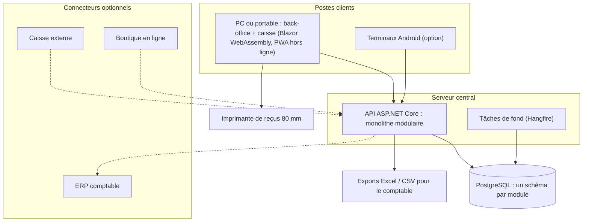

Le service d'ingestion de tickets, le relais Outbox et le broker de messages ne s'ajoutent que si une caisse externe ou un ERP est connecté.

**Modules et style interne**

| Module | Style | Raison |
| --- | --- | --- |
| Stock (noyau) | DDD tactique + architecture hexagonale | Invariants forts et concurrence (RG01 à RG04) |
| Caisse | DDD léger + synchronisation hors ligne | Numérotation, sessions, idempotence |
| Clients et crédit | DDD léger | Plafond, imputation des remboursements |
| Achats, Commandes clients | DDD avec machines à états | Cycles de vie (section 5) |
| Inventaire | DDD léger | Validation des écarts |
| Référentiel, Prix | CRUD simple | Peu de règles |
| Réapprovisionnement, Exports | Traitements planifiés ou à la demande | Calculs en lecture |
| Consultation, rapports | CQRS côté lecture (Dapper ou vues) | Pas d'agrégats à charger |

**Règles de dépendance**

1. Un schéma de base par module ; aucune jointure entre schémas dans le code métier.
2. Appel synchrone via le contrat public du module quand la cohérence doit être immédiate (Caisse ou Commandes → Stock).
3. Événements de domaine en mémoire pour les réactions sans transaction commune.
4. Seul le module Stock écrit les mouvements et les soldes.
5. Tests d'architecture (NetArchTest ou ArchUnitNET) dans la CI.

### 7.5 Base de données

| Option | Avantages | Inconvénients | Verdict |
| --- | --- | --- | --- |
| SQL Server Standard | Outillage riche | Licence coûteuse pour une petite entreprise | À écarter |
| SQL Server Express | Gratuit | Limité à 10 Go par base | Acceptable pour un site |
| PostgreSQL | Gratuit, sans limite de taille, pris en charge par EF Core (Npgsql) | Montée en compétence si l'équipe vient de SQL Server | **Retenu** |

### 7.6 Risques principaux

| Risque | Conséquence | Parade |
| --- | --- | --- |
| Soldes désynchronisés du journal | Disponible faux | Écriture transactionnelle unique + contrôle nocturne |
| Ventes hors ligne perdues (cache vidé, PC en panne) | Chiffre d'affaires et stock faux | Stockage persistant du navigateur, synchronisation immédiate, alerte visible, clôture bloquée |
| Fraude interne en caisse | Écarts de caisse | Comptes nominatifs, plafonds de remise, journal des annulations |
| Saisie manuelle des lots et DLC | Traçabilité inexploitable | Scan obligatoire lorsque les lots sont activés |
| Ventes à crédit hors système | Créances invisibles | Mode de paiement Crédit simple et rapide à utiliser |
| Inventaire pendant l'activité | Écarts fantaisistes | Blocage ou horodatage des mouvements de l'emplacement compté |

### 7.7 Codes-barres et QR

| Usage | Symbologie | Contenu utile |
| --- | --- | --- |
| Unité vendue | EAN-13, UPC-A, EAN-8 | GTIN |
| Unité vendue (transition 2D) | GS1 DataMatrix, QR GS1 Digital Link | GTIN + lot (AI 10) + DLC (AI 17) + série (AI 21) |
| Poids ou prix variable | EAN-13 à préfixe 2 | Article interne + poids ou prix |
| Colis et palettes | GS1-128 | SSCC (AI 00), GTIN, lot, DLC, quantité (AI 37) |
| Emplacements, articles sans code | Code 128 ou QR interne | Code interne |

GS1 porte l'initiative Sunrise 2027 : les caisses doivent pouvoir lire les codes 2D GS1 d'ici fin 2027, les EAN restant présents pendant la transition.

**Composant ScanParser** (bibliothèque partagée, sans accès base) : identifier la symbologie (identifiant AIM ou forme d'URI Digital Link), découper les AI (séparateur GS), valider la clé modulo 10, traiter le préfixe 2, sinon chercher un code interne, et retourner un ScanResult unique.

**Matériel** : douchette USB en émulation clavier, configurée pour transmettre l'identifiant AIM ; caméra du PC en appoint ; terminaux Android avec SDK constructeur prévus mais désactivés par défaut. Étiquettes en ZPL (imprimantes thermiques) ou PDF ; reçus sur imprimante thermique 80 mm. Bibliothèques .NET : ZXing.Net, QRCoder.

**Limite** : tant que les produits ne portent qu'un EAN-13, le lot vendu en caisse reste présumé.

### 7.8 Exploitation au Cameroun : mode dégradé et hébergement

| Opération | Hors ligne | Mécanisme |
| --- | --- | --- |
| Vente, avoir, remboursement de crédit en caisse | Oui | Stockage dans le navigateur (IndexedDB), identifiant d'idempotence, envoi au retour du réseau |
| Réception, rangement, réassort, comptage | Oui | Commandes horodatées rejouées dans l'ordre |
| Préparation de commande | Partiel | Liste téléchargée avant le départ |
| Réservation, confirmation de commande, transfert, validation d'écart | Non | Serveur central requis |
| Consultation du stock | Oui, en lecture | Cache avec date de dernière synchronisation affichée |

En cas de conflit au rejeu (lot bloqué entre-temps, plafond de crédit dépassé), le serveur enregistre l'opération qui a eu lieu sur le terrain et crée une anomalie à traiter ; il ne la rejette jamais silencieusement.

Le contrôle du plafond de crédit hors ligne s'appuie sur le dernier solde synchronisé ; un dépassement découvert à la synchronisation devient une anomalie.

Infrastructure : onduleurs pour le serveur, les PC, les imprimantes et le réseau local ; lien Internet de secours pour les sites critiques.

| Hébergement | Avantages | Inconvénients | Verdict |
| --- | --- | --- | --- |
| Datacenter au Cameroun | Données dans le pays, latence faible | Offre et SLA à vérifier | Option pour un client multi-sites |
| Cloud public hors du Cameroun | Services managés | Transfert soumis à autorisation, dépendance au lien international | Possible avec autorisation |
| PC serveur dans la boutique (mono-site) | Aucune dépendance à Internet, coût faible | Sauvegarde et maintenance sur place | **Retenu pour le premier client** (décision 16) |

---

## 8. Décisions et points ouverts

### 8.1 Décisions prises

| # | Sujet | Décision |
| --- | --- | --- |
| 1 | Valorisation | CUMP par article × site, frais d'approche inclus |
| 2 | Réservation | Au niveau article × site ; lot et emplacement alloués à la préparation |
| 3 | Stock négatif | Interdit, sauf sur l'emplacement de vente des magasins |
| 4 | Emplacements | Multi-articles par défaut, mono-article paramétrable |
| 5 | DLC résiduelle | Paramètre par client, en jours |
| 6 | Surlivraison | 0 % par défaut, tolérance par fournisseur |
| 7 | Comptabilité | Pas d'ERP : exports Excel/CSV ; connecteur ERP optionnel |
| 8 | Terminaux de scan | Prévus, désactivés par défaut, activés selon le besoin |
| 9 | Taille | Une seule entreprise, un à plusieurs sites, fonctionnalités activables |
| 10 | Contrôle qualité | Paramètre par article |
| 11 | Caisse | Caisse intégrée ; caisse externe connectable en option |
| 12 | Réserve / rayon | Paramètre par magasin |
| 13 | Codes 2D | Codes linéaires et 2D GS1 pris en charge dès la v1 |
| 14 | Poids variable | Pris en charge, structure paramétrable |
| 15 | SSCC | Exploités quand l'avis d'expédition existe |
| 21 | Base de données | PostgreSQL |
| 22 | Vente à crédit | Crédit client simple, activé par défaut |
| 23 | Vente au détail | Unité de stock = plus petite unité vendue ; prix par conditionnement |
| 24 | Poste de travail | PC ou portable, application web installable (PWA) hors ligne |
| 25 | Architecture | Monolithe modulaire, un seul processus serveur en configuration de base |

### 8.2 Décisions validées le 13/11/2026

| # | Sujet | Décision |
| --- | --- | --- |
| 28 | Lien mouvement / document d'origine | Clé générique TypeDocument + DocumentId ; intégrité vérifiée par le code et les tests |
| 35 | Phasage | V1 = boutique mono-site : stock, prix, caisse hors ligne, crédit, vente au détail, réception simple, inventaire, exports. Multi-sites, lots, commandes clients et terminaux en V2 |
| 16 | Hébergement | PC serveur dans la boutique |
| 32 | Sauvegarde | Sauvegarde locale horaire sur disque externe + copie chiffrée quotidienne hors de la boutique. Perte maximale : 1 h (panne), 1 jour (vol, incendie). Copie hors du Cameroun : sans données personnelles, ou avec autorisation (loi n° 2024/017) |
| 26 | Reçus | Imprimante thermique 80 mm (ESC/POS) ; reçu PDF disponible pour WhatsApp ou e-mail |
| 17 | Facturation électronique DGI | Préparée sans être implémentée : numérotation continue, tickets non modifiables, données fiscales stockées, génération du reçu isolée derrière une interface |
| 18 | Frais d'approche | Répartis au prorata de la valeur, clé modifiable par réception |
| 20 | Libellés | Libellé principal obligatoire + traduction facultative ; interface entièrement bilingue |
| 27 | Dettes fournisseurs | Suivi simple en V1 : montant dû par réception, paiements partiels, liste et export |
| 29 | Reprise des données | Import Excel (articles, prix, codes) + inventaire complet au démarrage |
| 30 | Rôles | Cinq rôles : Administrateur, Gérant, Comptable, Caissier, Magasinier (section 8.3) |
| 31 | Seuils | Fixés par le gérant ; tant qu'un seuil n'est pas défini, tout dépassement est soumis à validation |
| 33 | Rapports V1 | Ventes et marge ; stock et valeur ; créances et dettes ; caisse et anomalies. Autres rapports à la demande |
| 34 | Support | Installation et formation sur place, puis support à distance (WhatsApp, prise en main), mises à jour automatiques, guide bilingue |

### 8.3 Rôles et droits (V1)

| Rôle | Droits |
| --- | --- |
| Administrateur | Utilisateurs, rôles, paramètres, fonctionnalités activables, sauvegardes. Aucune opération de vente |
| Gérant | Prix, clients, seuils, validations (écarts de caisse, remises hors plafond), tous les rapports |
| Comptable | Lecture de tout, exports, frais d'approche, paiements fournisseurs, validation des clôtures de caisse, des écarts d'inventaire et de la démarque, gestion des plafonds de crédit. Ni vente ni modification de prix |
| Caissier | Vente, avoir et remise sous plafond, remboursement de crédit, sa propre caisse |
| Magasinier | Réception, inventaire, déclaration de démarque (validée par le Comptable ou le Gérant) |

### 8.4 Restant à mesurer sur le terrain

| # | Mesure | Action |
| --- | --- | --- |
| 9b | Volumétrie du premier client | Articles, ventes par jour, utilisateurs |
| 14b | Structure des codes à poids variable | Confirmer avec GS1 Cameroun |
| 19 | Connectivité de la boutique | Mesurer, pour dimensionner la synchronisation de la copie en ligne |
| — | Seuils | À saisir par le gérant au démarrage |

---

## Sources

- Loi n° 2024/017 en vigueur le 23 juin 2026 : https://droitmediasfinance.com/index.php/actualites/droit-tech-fintech/1297-cameroun-la-loi-sur-la-protection-des-donnees-a-caractere-personnel-entre-en-vigueur-ce-23-juin-2026
- Facturation électronique, loi de finances 2026 : https://edicomgroup.com/fr/blog/facturation-electronique-obligatoire-au-cameroun
- Fiche TVA de la DGI : https://impots.cm/sites/default/files/documents/FICHE%20TVA.pdf
- Codes-barres des produits locaux et préfixe 617 : https://www.foodbusinessmea.com/barcode-blues-reliability-issues-surface-in-local-products-in-cameroon/
- Déclaration GS1 sur les QR codes en caisse : https://gs1.org/sites/gs1/files/2024-06/global-industry-endorsement-statement-qr-codes-with-gs1-standards.pdf
- GS1 Digital Link et Sunrise 2027 : https://www.unitag.io/gs1-digital-link
